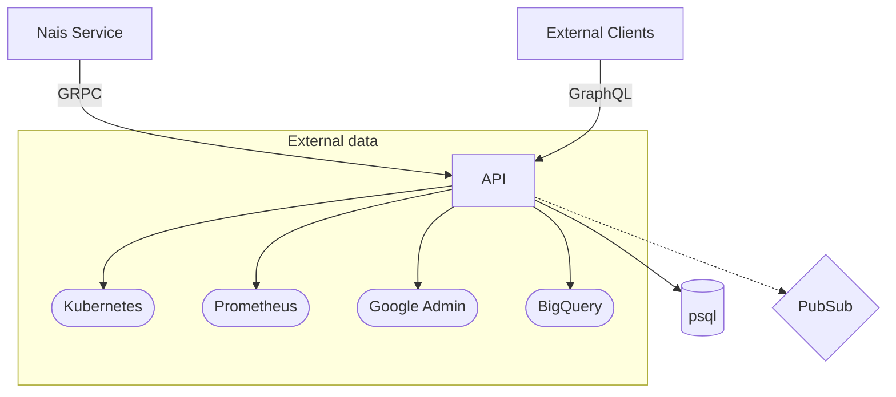

# Nais API

Nais API is the main entrypoint when interacting with the API of the Nais platform.

## Local development

```bash
mise install # Install required dependencies
cp .env.example .env # Copy example configuration file, and adjust to your needs
docker compose up -d
make setup-local # Setup local environment (seeds database and creates pubsub topic)
make local
```

For local development various services are faked.
This is controlled by multiple `WITH_*` environment variables in the `.env` file.
If `WITH_INSECURE_USER_HEADER` is set, you will also need to set the `X-User-Email` header to `dev.usersen@example.com` if you want
to act as a regular user, or `admin.usersen@example.com` if you need an admin user, when interacting with the GraphQL API.

Locally, most external services are replaced with fake clients, and the Kubernetes client reads data from `data/k8s`.

The test suite uses [testcontainers](https://testcontainers.com/), and if you are using Colima you might need to follow
the guidelines in the [testcontainers documentation](https://golang.testcontainers.org/system_requirements/using_colima/).

### Local development of logging API

To develop the logging API with real data:

```bash
TENANT_NAME="example.com"
nais login
narc jita grant k8s-admin "$TENANT_NAME" --duration 1h --reason "port forward for loki local testing"
CONTEXT="dev" WITH_LOG_PROXY="true" mise run local|debug
```

## Kafka environments

`KAFKA_ENVIRONMENTS` maps canonical Nais environment names to Kafka
pools and optional legacy aliases. Temporary credentials are created in the
selected canonical environment, using the existing cluster-name mapping.
For example, for Nav:

```json
{
	"dev-gcp": {
		"pool": "nav-dev",
		"aliases": ["dev"]
	},
	"prod-gcp": {
		"pool": "nav-prod",
		"aliases": ["prod"]
	}
}
```

The Helm value is the JSON string `kafka.environments`. For ordinary
tenant environments, Fasit generates a mapping when both `aiven_project` and
`kafka_bootstrap_broker` are configured. The pool is the configured Aiven project,
and credentials are created in the same Nais environment, without aliases.
Nav retains the explicit legacy mappings above.

Non-standard topologies can configure an explicit mapping. A direct Helm
installation must also supply this value. An empty mapping disables Kafka
credential creation, not other Kafka operations.

The canonical environment must refer to a configured Kubernetes cluster through the existing environment-name
mapping. Aliases cannot collide with canonical Nais environments or other aliases.
Pool names are never inferred from environment names or the tenant name.
An environment without a mapping is rejected before creating any resources.
Selecting a shared pool does not route credential creation to another cluster.
There is no routing from FSS to GCP.

Existing clients can keep using configured aliases. The additive
`CreateKafkaCredentialsPayload.environmentName` field returns the canonical name,
allowing newer clients to warn about legacy aliases without duplicating this
configuration. Activity log entries use the canonical name.

## v0s migration

The new vulnerability fields read v0s through the public
[v0s gRPC client module](https://github.com/nais/v0s-api). Existing
v13s queries and mutations keep their existing source and behavior.

Set `V0S_ENDPOINT` to the plaintext gRPC endpoint allowed by v0s's NetworkPolicy.
The connection is lazy: an unset endpoint or unavailable v0s does not block API
startup, workload inventory, or legacy vulnerability fields. New fields return
errors rather than silently falling back to v13s or reporting zero findings.
Environment names are the same user-facing names used by `Workloads.ListImages`.

`V0S_SUPPRESSIONS_ENABLED` defaults to false. Keep it false while v13s owns
assessments and synchronizes them into v0s. Enable only after old user writes are
frozen, synchronization has caught up, and the sync worker and its retries have
stopped. The new mutations authorize the whole team's batch and derive the actor
from the authenticated user. Deletions do not require an active finding.
Successful sets and deletions are recorded in the team's activity log.

New lists are forward-only (`first` from 1 to 200) and use the standard
`edges`, `nodes` and `PageInfo` contract. `totalCount` covers the full filtered
selection and is loaded only when requested; counting suppressions currently
pages through the matching assessments. `pageStart` and `pageEnd` track positions
in the traversal; concurrent updates can change the total. Findings and
suppressions are available at the root and scoped through `Team` and
`TeamEnvironment`. Findings are also available on each workload.
`vulnerabilityFindings.facets` describes the full filtered selection, including
when filtering by multiple vulnerability identifiers or aliases.
Findings, advisories and assessments have global IDs and can be fetched through
`node`. A finding's ID includes its image digest, so an obsolete-image finding
is not returned after the workload changes images. Assessments for workloads
missing from current inventory are not listed or returned by `node`, but are
not deleted from v0s. The activity log stores assessment details independently.

Keyset cursors wrap v0s's per-item tokens and are scoped to the operation and
filter. They remain usable when an earlier item disappears, and cannot be used
with the old offset-paginated fields. Deploy v0s with per-item cursors and
multiple-identifier filtering before configuring `V0S_ENDPOINT` for this API.

`workloads.facets.vulnerabilityCoverage` counts scan statuses across the full
workload selection. Use `Team.workloads(filter: {vulnerabilityCoverageStatuses:
[PENDING]})` to find workloads awaiting a scan. Coverage uses current API
inventory: workloads missing from v0s or associated with an old image are
pending, not clean. Removed workloads and old-image findings are excluded.

The pinned v0s protobuf schema is in `internal/v0s/protoapi/schema/v0s.proto`.
`mise run generate:proto` generates the client locally, without depending on the
v0s scanner module or its Go version. Update the pinned schema and regenerate when
the upstream contract changes.

## Development practices

Check practices used in this project here: [docs/practices.md](docs/practices.md)

### Adding a product-specific relay access mutation

Follow the [shared relay integration requirements](https://github.com/nais/relay/blob/main/SERVICE-INTEGRATION.md) and fill in the [integration template](https://github.com/nais/relay/blob/main/SERVICE-INTEGRATION-TEMPLATE.md) in the product's design or rollout documentation. A new access must be requested through an authenticated, product-specific NAIS API mutation; document its authorization, target selection and owner-only delivery before enabling it.

### Graph-API

We have defined a set of practices for the Graph-API in the [docs/graphql_practices.md](docs/graphql_practices.md) file.

## Fake clients

We have a set of fake clients, and stubs, that can be used for local development.
One of the clients is a fake Kubernetes client that read data from `data/k8s`.
You can read more about how the fake clients works in the [data/k8s/README.md](data/k8s/README.md) file.

## Integration tests

We are using [tester](https://github.com/nais/tester) for integration tests.
These tests are written in Lua and can be found in the `integration_tests` directory.

A spec file is generated to support auto-completion using the Lua language server.

When running `make test` the integration tests will be run as part of the test suite.
If you only want to run the integration tests, and get information about coverage, you can run `make integration-test`.

To run the integration tests in watch mode, run `make integration_test_ui`.
This will start a web server on `localhost:9876` where you can see the test results.
They will be re-run every time you save a `.lua` file.

## Architecture



| Component        | Description                                                                                |
| ---------------- | ------------------------------------------------------------------------------------------ |
| API              | This service                                                                               |
| Postgres         | The postgres database storing state from this application                                  |
| Nais Service     | Services by Nais that requires special communication with API. E.g. Reconcilers and Deploy |
| External Clients | External clients that communicates with the API. E.g. Browsers and NADA                    |
| Kubernetes       | The Kubernetes clusters of the tenant                                                      |
| PubSub           | The PubSub topic used for communication between the API and the Nais Service               |
| Prometheus       | We collect historic data from the tenants prometheus                                       |
| Google Admin     | We use the Google Admin API to manage a list of users                                      |
| BigQuery         | We collect historic cost data from BigQuery                                                |

## Code generated by GitHub Copilot

This repository uses GitHub Copilot to generate code.
