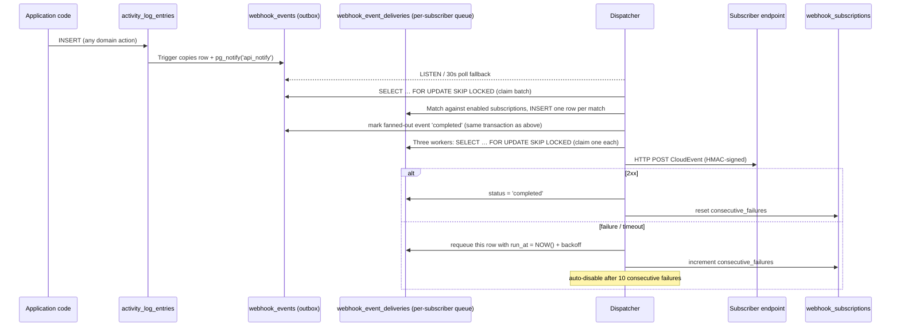

# Webhook System

Sends HTTP callbacks to user-registered endpoints when activity log events occur.
Supports team-scoped and global subscriptions, HMAC-signed CloudEvents 1.0 payloads,
durable delivery via a PostgreSQL outbox, and automatic retry with exponential backoff.

## Flow

Processing happens in two stages: outbox events are fanned out into per-subscription
delivery rows, and each delivery row is then retried independently of the others.

Each API replica runs one fan-out loop and three independent delivery workers. Workers
claim one delivery at a time directly from PostgreSQL; there is no in-memory delivery
queue or batch barrier. Fan-out wakes all workers after each committed batch, and wake-ups
are coalesced. Each worker also polls every 30 seconds for missed wake-ups and due retries.
Slow HTTP requests do not block fan-out or the other delivery workers.
On shutdown, workers stop claiming new work and finish active deliveries and bookkeeping,
with a 20-second deadline per active delivery.

Delivery order is not guaranteed, including within one subscription. Failure counters
follow the order in which results are recorded in PostgreSQL, not event creation order.
Updating the counter and automatically disabling a subscription happen atomically.



## Key components

| File             | Responsibility                                                         |
| ---------------- | ---------------------------------------------------------------------- |
| `dispatcher.go`  | Outbox consumer: LISTEN/NOTIFY + poll, fan-out, claim, deliver, retry  |
| `cleaner.go`     | Daily leader-only pruning of processed outbox/queue and old deliveries |
| `cloudevents.go` | Build CloudEvents 1.0 envelope; derive `type` from activity type       |
| `signer.go`      | HMAC-SHA256 payload signing (`X-Webhook-Signature` header)             |
| `model.go`       | Domain types; `MatchesEvent` subscription/event matching logic         |
| `queries.go`     | CRUD operations with authorisation                                     |
| `dataloader.go`  | Context-scoped DB + dispatcher access                                  |

## Database tables

- **`webhook_subscriptions`** — registered endpoints (URL, secret, event_types, team scope)
- **`webhook_events`** — lightweight outbox; each row is just a reference (`activity_log_entries_id`) to the source event, inserted by a PostgreSQL trigger on `activity_log_entries`. No data duplication. A row's job is done once it has been "fanned out" (see below); it doesn't track delivery outcomes itself.
- **`webhook_event_deliveries`** — one row per `(webhook_event, subscription)` match, created by the dispatcher's fan-out step. This is the actual unit of retry: `status`/`retry_count`/`run_at` here are scoped to a single subscriber's delivery of a single event, so retries never touch other subscribers.
- **`webhook_deliveries`** — audit log of every actual HTTP delivery attempt, optionally linked back to the `webhook_event_deliveries` row that produced it.

Request and response bodies are stored as `bytea`, preserving the bytes used for signing
and the bytes read from the response. Responses are limited to 10 KiB, with
`responseBodyTruncated` identifying truncated captures. Transport/read failures are stored
separately in `errorMessage`, not mixed into the response body.
Requests explicitly ask for identity encoding so the HTTP client does not transparently
decompress response bodies before recording them.

GraphQL exposes the JSON request as `requestBody` and UTF-8 responses as `responseBody`.
Binary responses have a null `responseBody`, while their exact bytes remain in storage.
An absent response has a null body; an empty response has an empty string.

Recorded headers preserve multiple values. Requests only retain diagnostic headers:
Accept, Accept-Encoding, Content-Type, Content-Length, Content-Encoding, User-Agent,
Date, Retry-After, Server, X-Request-Id, Traceparent, and X-Webhook-Signature.
Responses retain all headers except known authentication, API-key, token, and cookie
headers (including authentication challenges, authentication-info, and CSRF tokens).
Custom response headers can still contain sensitive values; this filtering cannot
identify arbitrary application-specific secrets.

### Why two stages?

Subscription matching (all-event selection, team scoping) is application logic that
lives in Go (`activitylog.RegisterActivityType`/`MatchesEvent`), so it can't be done by the
trigger. The trigger only records that an event happened; the dispatcher fans it out into
one delivery row per matching subscription, and retry/backoff bookkeeping happens at that
level.

## Multi-instance safety

The dispatcher is started on every API replica (`go webhookDispatcher.Run(ctx)`, unconditional — no leader election). This is safe:

- Postgres `NOTIFY` on `api_notify` is broadcast to every connection currently `LISTEN`ing on it, so all replicas wake up when new work arrives (plus a 30s poll fallback per replica in case a notification is missed).
- Both the fan-out claim (`ClaimOutboxEventsForFanout`) and the delivery claim (`ClaimPendingDeliveries`) use `SELECT ... FOR UPDATE SKIP LOCKED`. Concurrent workers or replicas racing on these queries cannot claim the same row in that claim cycle. Each replica adds three delivery workers; retries can still produce duplicate HTTP deliveries.
- Fan-out (claiming an event, matching subscriptions, inserting delivery rows, marking the event completed) happens in a single DB transaction. `CreateEventDelivery` is idempotent (`ON CONFLICT (webhook_event_id, subscription_id) DO NOTHING`), so an interrupted or repeated fan-out attempt is safe.
- Delivery marks a `webhook_event_deliveries` row `processing` at claim time and only
  marks it `completed` after success. Claims expire after one minute and can then
  be reclaimed by another worker. A new claim token prevents the previous worker
  from completing or rescheduling the reclaimed job. Active processing rows are
  excluded from retention cleanup.

## Retention & cleanup

`RunCleaner` runs once a day on every replica, but only the current leader (via `leaderelection.IsLeader`) actually performs deletes, so pruning happens exactly once cluster-wide per interval:

- `webhook_events` and `webhook_event_deliveries` (internal processing state) are pruned after 7 days.
- `webhook_deliveries` (the user-facing delivery audit log) is pruned after 30 days.

## Event types

Event types are driven by `activitylog.RegisterActivityType` calls throughout the codebase.
Registered activity types are available as subscribable event types unless marked with
`activitylog.IgnoreWebhook()`. A description is required after the resource type.
Option functions allow customising grouping or scope.

```go
// Any domain package's init():
activitylog.RegisterActivityType(
    "TEAM_MEMBER_ADDED",
    activitylog.ActivityLogEntryActionAdded,
    resourceType,
    "A user was added to the team",
    activitylog.WithGroup("Team"),                               // Custom UI grouping
)

// Global/admin-only event types can be marked so team-scoped webhooks cannot subscribe to them:
activitylog.RegisterActivityType(
    "RECONCILER_ENABLED",
    action,
    resourceType,
    "Triggered when a reconciler is enabled.",
    activitylog.GlobalOnly(),
)
```

The `webhookEventTypes` GraphQL query exposes the full catalogue with descriptions, groups, and `teamScoped` status.

Set `events: { allEvents: true }` to receive all available event types within the webhook's scope,
or provide `events: { eventTypes: ["TEAM_MEMBER_ADDED"] }` with a non-empty list.
`WebhookEventSelection @oneOf` requires exactly one non-null field. False, empty lists,
and `"*"` are rejected.
Creation requires `events`; on update, it replaces the selection.
Omitting `events` or passing null on update preserves the current selection. Team-scoped webhooks cannot
explicitly select `GlobalOnly` event types and never receive them through `allEvents`.

`IgnoreWebhook()` excludes an event type from the catalogue and rejects explicit
subscriptions. Ignored events are never delivered, including through all-event or existing
subscriptions. Already queued deliveries and retries are also skipped if their event type
is ignored. Activity log entries remain available through the activity log.

`DEPLOYMENT`, `APPLICATION_SCALED`, `CLUSTER_AUDIT`, and `VULNERABILITY_UPDATED`
are excluded, along with Tunnel and Unleash events.

### Event payloads

New activity log payloads use camelCase JSON keys. Both `JOB_TRIGGERED` and
`JOB_RUN_DELETED` include `data.data.runName`, identifying the affected run while
`data.resourceName` identifies the parent job.

Payload data is forwarded from the stored activity log entry without rewriting historical
entries. Older Secret and job-run deletion entries can therefore still contain PascalCase
keys, and older `JOB_TRIGGERED` entries have no run name.

## CloudEvents type mapping

The PostgreSQL trigger stores events as `RESOURCE_TYPE:ACTION` (e.g. `TEAM:ADDED`).
The dispatcher resolves this to an `ActivityLogActivityType` via `LookupActivityTypes`, then converts
it to a CloudEvents-spec type string:

```
TEAM_MEMBER_ADDED  →  io.nais.team.member.added
POSTGRES_DELETED   →  io.nais.postgres.deleted
SERVICE_ACCOUNT_CREATED → io.nais.service_account.created
GENERIC_KUBERNETES_RESOURCE_CREATED → io.nais.kubernetes_resource.created
```

`cloudEventTypeGroupPrefixes` maps activity type prefixes to CloudEvents group names,
allowing compound names to retain underscores or be renamed.
The remaining event name is dot-separated. The longest matching prefix wins.

### Idempotency / deduplication

The CloudEvents `id` field is set to the `webhook_event_deliveries` row's own id, which is
stable across retries of that specific `(event, subscription)` delivery — it does **not**
change if a delivery is retried after a failure. Subscribers that need exactly-once
processing semantics should treat delivery as **at-least-once** and deduplicate on `id`.

The envelope `time` and `data.triggeredAt` contain the originating activity's timestamp,
not the delivery attempt time. `data.activityLogEntryId` contains its raw UUID, shared
across subscriptions. Retried requests retain the same event ID, timestamp, and body.

## Manual test events

Creating a subscription does not contact the endpoint. Use
`testWebhook(input: { id: ... }) { delivery { ... } }` to send a signed
`io.nais.webhook.test` event. Its data contains `test: true`, the requesting actor,
and the trigger timestamp; it has no originating activity-log ID.

Tests use the normal HTTP and diagnostic-recording path, but make one attempt, have
no queue entry or retries, and never increment or reset subscription failure counters.
They can be sent while a subscription is disabled. The mutation requires update
permission and is limited atomically in PostgreSQL to one test per subscription per
30 seconds. Tests are recorded only in the delivery history, not in the activity log.

## Retry schedule

| Attempt | Delay    |
| ------- | -------- |
| 1       | 1 min    |
| 2       | 5 min    |
| 3       | 15 min   |
| 4       | 1 hour   |
| 5       | 4 hours  |
| 6       | 8 hours  |
| 7       | 12 hours |

After the initial attempt and 7 failed retries the delivery is marked `failed`. After 10 consecutive failures across
any deliveries, the subscription is automatically disabled (`enabled = false`, `disabled_at` set).
Retries and the failure counter are both scoped per subscriber — one broken subscriber
retrying (and eventually being auto-disabled) has no effect on other subscribers of the
same events.

Each recorded attempt exposes its own `deliveryState`: `COMPLETED` or `FAILED`,
the number of attempts made up to that attempt, and any retry time scheduled after
that failure. Retry times are historical snapshots, not the current queue schedule.
Later retries, subscription changes, and queue pruning do not alter earlier results.
Manual tests also have a state, always with one attempt and no retry timestamp.
Disabled subscriptions pause queued deliveries until re-enabled.

## Authorisation

Reads of subscriptions, delivery diagnostics, and subscription activity logs require
the owning team's `webhooks:read` permission, granted to both members and owners.
Admins can also read team webhooks. Global subscriptions require admin access.
The same checks apply to direct node lookups.

| Action                            | Allowed                                    |
| --------------------------------- | ------------------------------------------ |
| Read team webhooks and deliveries | Team member, team owner, or admin          |
| Global webhook                    | Admin (Go-level check, not a DB role)      |
| Create / update / delete / test   | Owner of the subscription's team, or admin |

## Endpoint policy

Endpoints must use HTTPS hostnames without URL credentials or fragments. Redirects
are recorded as failed HTTP attempts, not followed. Each connection resolves and
checks all destination addresses, then connects directly to an approved address
without a second DNS lookup or an environment-configured proxy.

Public destinations are allowed. Private addresses are allowed only for hostnames
under `intern.<tenant>.cloud.nais.io`, such as
`myapp.intern.mytenant.cloud.nais.io`. Loopback, link-local, metadata, and other
reserved destinations remain blocked even for these internal ingress names.

For local development only, explicitly enable unrestricted HTTP/HTTPS destinations:

```sh
WITH_INSECURE_WEBHOOK_URLS=true mise run local
```

This allows endpoints such as `http://localhost:32424/path` during creation, updates,
manual tests, and event delivery. The setting is **false by default** and enabling it
emits a startup warning. It disables HTTPS-only and destination-IP restrictions,
including protections against access to internal and metadata services; never enable
it in a shared or production environment.
Redirects remain disabled, TLS certificates are still verified, and URL credentials
and fragments remain prohibited. When running the API in a container, `localhost`
refers to that container, not the host.

## Monitoring & Metrics

The webhook domain exports telemetry using native OpenTelemetry metrics under the meter name `webhook`:

### PromQL Alerts Examples

1. **Increasing delivery queue size** (Potential worker blockage or overload):

   ```promql
   max(nais_api_webhook_queue_size{status="pending"}) > 100
   ```

   _Trigger conditions_: `nais_api_webhook_queue_size` reads shared Postgres state (a plain `COUNT(*) GROUP BY status`), so **every** replica reports the identical number — it is not gated behind leader election. Use `max()` or `avg()` when aggregating across replicas, **not `sum()`**, since summing would multiply the true value by the replica count.

2. **High webhook delivery failure rate**:

   ```promql
   sum(rate(nais_api_webhook_deliveries_total{success="false"}[5m])) / sum(rate(nais_api_webhook_deliveries_total[5m])) * 100 > 10
   ```

3. **Auto-disabled subscriptions rate**:

   ```promql
   sum(rate(nais_api_webhook_subscriptions_auto_disabled_total[1h])) > 0
   ```
